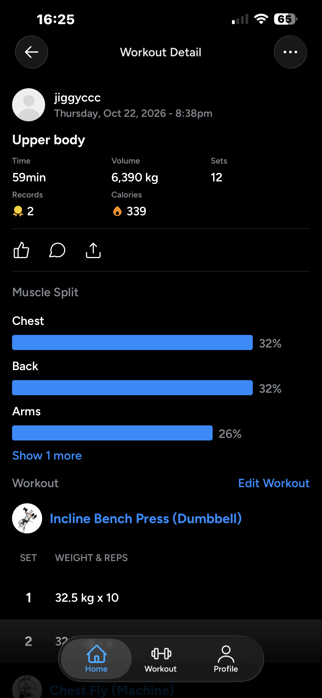
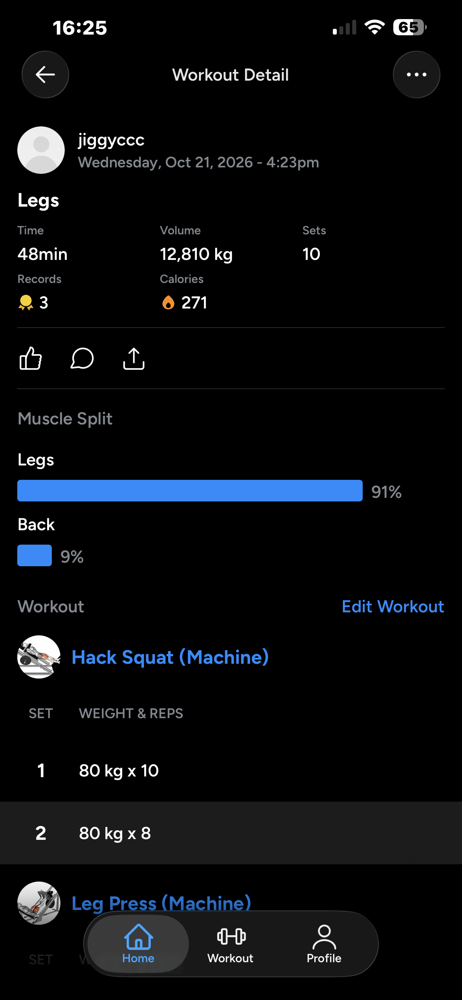
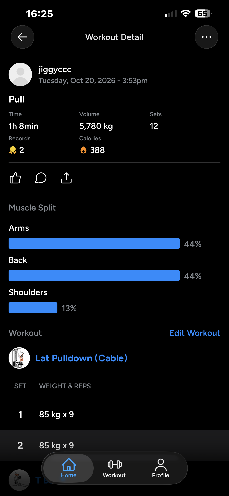
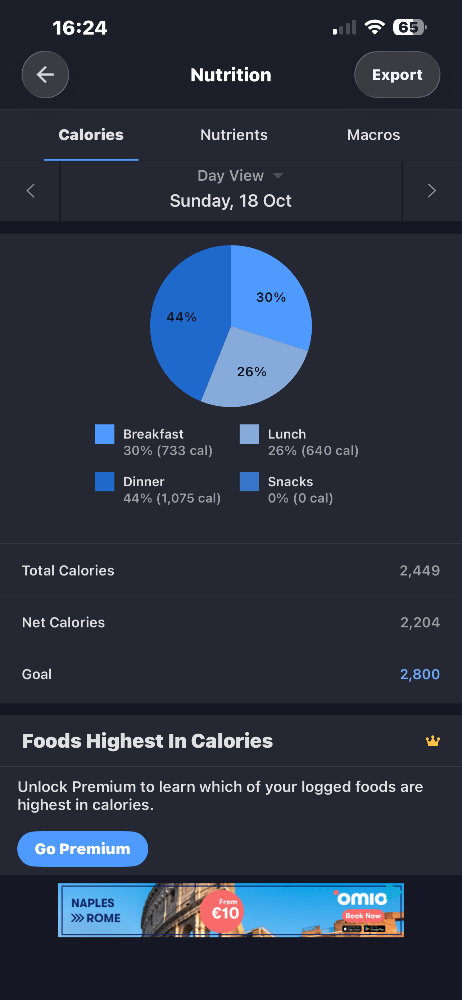
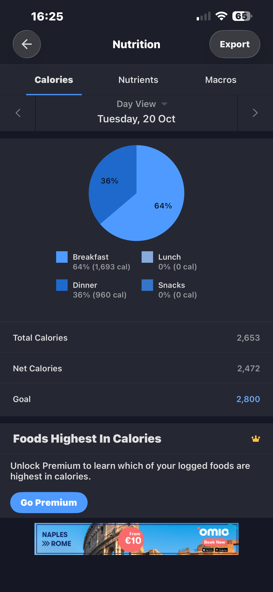
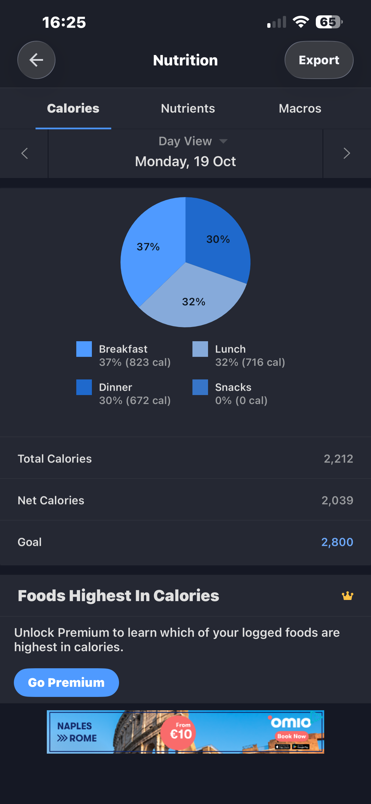

# My_Data_centric_Programming_assignment
# Questions for My_Data
1. Does workout duration affect how much my mood improves after exercising? 

1. Does consuming an energy drink affect my workout duration and mood improvement? 

1. Does the time i start my workout influence my workout duration and mood improvement? 

## Data Dictionary 
Some of this data is collected by using two apps, Hevy and MyFitnessPal. Hevy allows me to track my workout whilst MyFitnessPal allows me to track my calories. 

| Column | Data Type | Units | Measurements / Definitions |
|---|---|---|---|
| Date   | dates     | day-month-year | The day that this entry is recored | 
| Muscle Group | Categorical | String | What muscle group I have worked for this entry | 
| duration_minutes | Numeric | Integer | How long the workout has taken to complete | 
| start_time | Time | Hour and Minutes | What time I started the workout | 
| mood_before(0-5) | Categorical | Integer | What mood i was in before going to the gym | 
| mood_after(0-5) | Categorical | Integer | What mood i was in after going to the gym |
| Calories_consumed | Numeric | Integer | How many calories i have consumed that day | 
| Energy Drink(0-1)| Numeric | Boolean | Did i have an energy drink before the workout | 

## Hevy Workout Data

  
  
  

## MyFitnessPal Nutrition Data

  
  
  

## Description of my project 

This project used my own collected data about my gym workouts. With this data, I used python libraries such as pandas, matplotlib and sqlite3 to analyse, clean, filter, create graphs, and run SQL queries. My project allows users to interact with my data and add their own data to my database

## Instructions

Using the files "main.py" and "My_Data.csv" under the folder "dcp26project" and running the "main.py" in VScode, you will be able to see my menu interface that allows you to interact, analyse my data and add your own workout.

## How it works: 
My_Data.csv is imported into a database called gym.db using sqlite3. Using sqlite3's query tools I am able to investigate relationships between different attributes in my table "gym_statistics" and allow users to insert their own workouts.

Pandas is used to retrieve, filter and analyse the entries and calculate the attribute statistics. 

Matplotlib is used to to display graphs that help visualise results. In this case I use scatter plots, histograms and bar charts. 

The program also allows users to use an interactive menu which they can explore my data with. 

## Findings
### Matplotlib findings: 

-- I found that the average workout duration is increased when an energy drink is consumed and mood is improved when an enrgy drink is not consumed. 

-- I found that mood improvement is more likely if the workout takes under an hour. 

-- The earlier I start my workout leads to a longer workout. More than likely because i was under any time pressure. Whereas later in the day the workout is shorter. 

-- I aslo found that most of my workouts take between 50 and 60 minutes.

### sqlite3 findings: 
Question 1: Does workout duration affect how much my mood improves after exercising? 
Mood improvement seems to always imrpove by duration, except for a few where the improvement stays the same 

question 2: Does consuming an energy drink affect my workout duration and mood improvement?
I found that consuning an energy generaly improves the average duration of my workouts but it has a lower average for mood improvement compared to consumung no energy drink. 

Question 3: Does the time i start my workout influence my workout duration and mood improvement?
Similar to the matplotlib findings, sqlite3 queries also show a longer workout duration if the workout is started earlier in the date. Other than that, i found that mood improvement is more likely towards later in the day.

